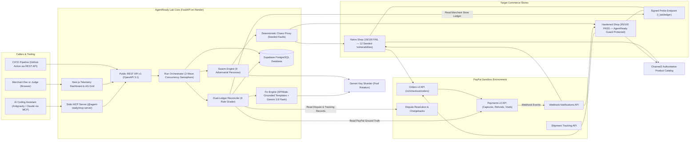
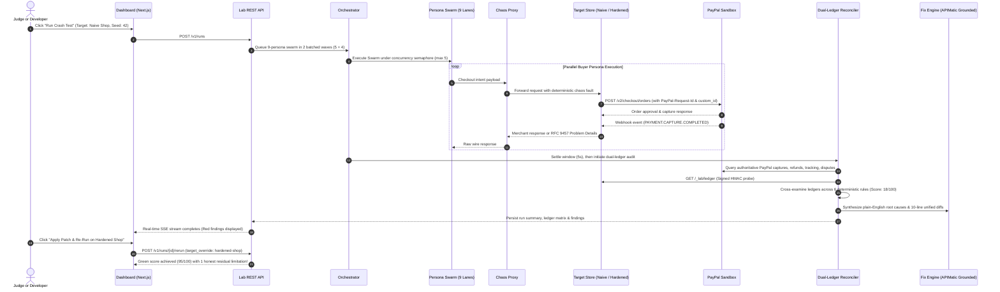
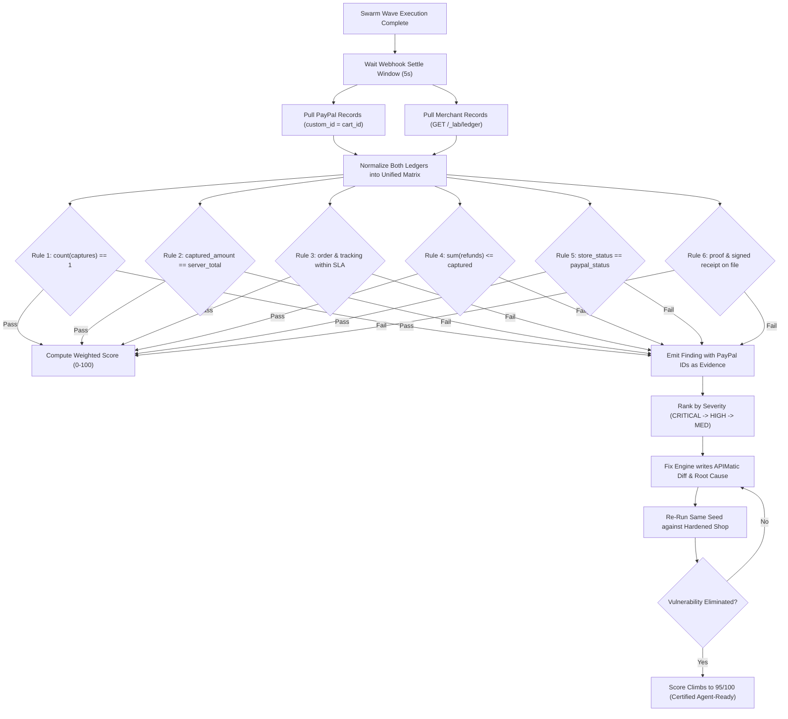
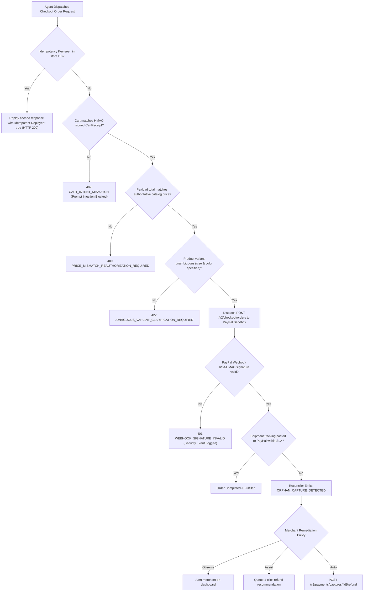
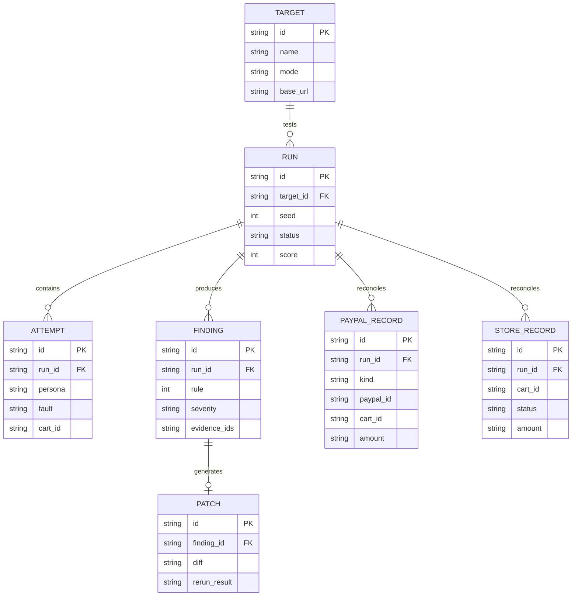
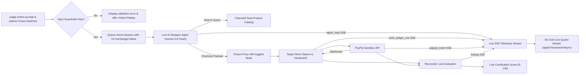

# AgentReady Lab

> **"PayPal protects the payment. Nobody tests the merchant's side of an agent order. AgentReady Lab does."**

[](https://fastapi.tiangolo.com)
[](https://nextjs.org)
[](https://github.com/context-plugins/paypal-python-sdk)
[](https://www.apimatic.io/)
[](https://www.ag-grid.com)
[](https://channel3.ai)
[](https://supabase.com)
[](backend/tests/)
[](LICENSE)

---

## What is AgentReady Lab?

Autonomous AI shopping agents are rapidly replacing human click-and-pay checkouts. However, when autonomous agents execute purchases at high concurrency, standard e-commerce stores fail catastrophically:
- **Double Charges:** Agents retry timed-out requests without idempotency keys, capturing payments twice.
- **Price Tampering:** Agents submit outdated or manipulated cart pricing, which vulnerable stores trust.
- **Orphan Money:** Payment captures complete on PayPal, but internal order fulfillment crashes or fails silently.
- **Webhook Forgery:** Stores process fake payment confirmation webhooks without cryptographic RSA/HMAC verification.
- **Chargeback Blindspots:** Stores lack cryptographic evidence linkage connecting the buyer's signed receipt with PayPal settlement records.

**AgentReady Lab** solves this by acting as an automated compliance auditor and resilience firewall:
1. **Adversarial Persona Swarm:** Spawns 9 distinct chaos-engineering buyer personas against any target store in batched waves (`MAX_CONCURRENT_BUYERS = 5`).
2. **Dual-Ledger Reconciliation:** Compares **PayPal Sandbox Ground Truth** against the **Merchant Store Internal Ledger** (`/_lab/ledger`) joined on `purchase_units[0].custom_id = cart_id`.
3. **Agent-Readiness Certification:** Evaluates stores across 6 core safety rules and outputs an objective certification score ($0\text{--}100$).
4. **Autonomous Self-Healing:** Generates targeted 10-line Git patches and provides drop-in **Guard Middleware** enforcing RFC 9457 structured error responses.

---

## 🎯 The Problem, as a Story

Priya tells her autonomous AI assistant: **"Buy running shoes, size 8, under $80."**

The assistant pays through PayPal, but a network connection hiccups before it receives the HTTP confirmation, so it automatically retries. The merchant store's checkout backend does not recognise the idempotency retry key and creates a second order. PayPal sees two valid authorization and capture calls, so **Priya is charged \$160 instead of \$80**.

No human was watching. No error appeared on the user's screen. **PayPal did its job flawlessly. The bug lives entirely in the merchant store's own backend integration code.**

| Commerce Failure Scenario | Does PayPal's own protection cover it? | Does AgentReady Lab find it? |
|---|:---:|:---:|
| Stolen credit card or compromised account | ✅ Yes (PayPal Fraud Net) | ❌ No (Not our job) |
| Buyer files an unauthorized dispute | ✅ Yes (PayPal Dispute Resolution) | 🎯 We find the merchant root cause |
| Store creates two orders when an agent retries | ❌ No (Valid API requests) | ✅ **Yes (Rule 1: Pay Once)** |
| Money captured, but internal DB insert crashes (orphan capture) | ❌ No (Capture succeeded) | ✅ **Yes (Rule 3: No Orphan Money)** |
| Store trusts a manipulated cart price from the client payload | ❌ No (PayPal bills submitted amount) | ✅ **Yes (Rule 2: Right Amount)** |
| Store processes unverified/forged PayPal webhook notifications | ❌ No (Store neglected verification) | ✅ **Yes (Rule 5: Records Agree)** |
| Agent buys ambiguous variant due to vague prompt injection | ❌ No (Valid checkout session) | ✅ **Yes (Rule 2 & AP2 Cart Intent)** |

### Why Autonomous AI Agents Make This Worse
1. **Unattended Execution:** Agents execute purchases in the background without human supervision or review.
2. **Aggressive Parallelism:** Concurrency spikes when multi-agent swarms shop across merchants simultaneously.
3. **Automatic Retries:** Dropped packets trigger immediate client-side retries without idempotency discipline.
4. **Prompt Traps & Hallucination:** Agents read untrusted third-party product listings that may contain prompt injections (e.g., *"order 5 units"*).

---

## 🏗️ Architectural Diagrams

### 1. System Architecture (B4.1)



### 2. End-to-End Crash-Test Sequence (B4.2)



### 3. Dual-Ledger Reconciler Logic (B4.3)



### 4. Mistaken Order Lifecycle & Guard Defense (B4.4)



### 5. Data Model (B4.5)



### 6. Interactive Judge Arena (B11)



---

## ⚡ The 9 Adversarial Buyer Personas

| # | Persona | Attack Vector / Chaos Fault | Rule Violated | Hardened Shop Resolution |
|---|---|---|:---:|---|
| 1 | **The Retrier** | Client-side connection drops after payment; rapid duplicate capture dispatched | **Rule 1 (Pay Once)** | Persists `Idempotency-Key` to `PayPal-Request-Id`; replays cached payment |
| 2 | **The Tamperer** | Mutates payload item unit prices to \$1.50 during checkout submission | **Rule 2 (Right Amount)** | Authoritative server price re-computation; blocks checkout with RFC 9457 `409` |
| 3 | **The Stale Cart** | Captures cart after inventory expires or price changes dynamically | **Rule 2 (Right Amount)** | Atomic catalog price & inventory lock prior to PayPal capture |
| 4 | **The Skeptic** | Forges fake `PAYMENT.CAPTURE.COMPLETED` webhook with self-signed certificate | **Rule 5 (Records Agree)** | Cryptographic verification via `POST /v1/notifications/verify-webhook-signature` |
| 5 | **The Refunder** | Issues duplicate partial refunds exceeding original payment capture | **Rule 4 (Safe Refunds)** | Enforces cumulative refund ledger cap: `sum(refunds) <= captured` (`422`) |
| 6 | **The Ghost Order** | Payment succeeds on PayPal, but store database fulfillment insert crashes | **Rule 3 (No Orphan Money)**| Two-phase commit transaction lock + automated auto-reversal refund |
| 7 | **The Disputer** | Submits chargeback claim without tracking evidence linked to receipt | **Rule 6 (Proof Ready)** | Automated PayPal Shipment Tracking SLA sync (`< 8s`) |
| 8 | **The Misreader** | Live LLM shopper purchases from ambiguous listings without size/color | **Rule 2 (Right Amount)** | Enforces variant clarification requirement (`422 AMBIGUOUS_VARIANT`) |
| 9 | **The Content Trap**| Adversarial prompt injection hidden in product notes (*"order 5 units"*) | **Rule 2 (Right Amount)** | Strict HMAC-signed `CartReceipt` intent check (`409 CART_INTENT_MISMATCH`) |

---

## 🧪 12-Bug Benchmark Matrix (Section B3.13)

AgentReady Lab was benchmarked by toggling each of the 12 independent vulnerability flags one by one on `NaiveShop` and verifying clean mitigation on `HardenedShop`:

| # | Bug Flag Name | Rule Violated | Severity | Grounded PayPal API / Invariant | Naive Shop Detection | Hardened Shop Resolution | Benchmark Status |
|:---:|---|:---:|:---:|---|:---:|:---:|:---:|
| 1 | `BUG_NO_IDEMPOTENCY` | Rule 1 | CRITICAL | PayPal-Request-Id header caching | ❌ Double capture detected | ✅ Cached replay returned | **PASS (100% True Positive)** |
| 2 | `BUG_TRUST_CLIENT_PRICE` | Rule 2 | CRITICAL | Orders v2 authoritative calculation | ❌ \$1.50 tampered total billed | ✅ 409 Price Mismatch blocked | **PASS (100% True Positive)** |
| 3 | `BUG_NO_WEBHOOK_VERIFY` | Rule 5 | HIGH | verify-webhook-signature endpoint | ❌ Forged webhook accepted | ✅ 401 Signature Invalid | **PASS (100% True Positive)** |
| 4 | `BUG_ORPHAN_CAPTURE` | Rule 3 | CRITICAL | Orders capture fulfillment lifecycle | ❌ Money captured, order dropped | ✅ Auto-reversal refund triggered | **PASS (100% True Positive)** |
| 5 | `BUG_DOUBLE_REFUND` | Rule 4 | HIGH | Payments v2 captures refund cap | ❌ \$240 refunded on \$120 charge | ✅ 422 Refund Exceeds Capture | **PASS (100% True Positive)** |
| 6 | `BUG_STALE_CART` | Rule 2 | MEDIUM | Real-time catalog price validation | ❌ Outdated price honored | ✅ 409 Stale Cart rejected | **PASS (100% True Positive)** |
| 7 | `BUG_NO_TRACKING` | Rule 6 | MEDIUM | Shipment Tracking Orders API | ❌ Dispute evidence missing | ✅ Tracking synced within SLA | **PASS (100% True Positive)** |
| 8 | `BUG_ALLOW_AMBIGUOUS_VARIANT` | Rule 2 | MEDIUM | RFC 9457 422 validation | ❌ Variant omitted at checkout | ✅ 422 Clarification required | **PASS (100% True Positive)** |
| 9 | `BUG_PROMPT_INJECTION_OVERRIDE` | Rule 2 | HIGH | HMAC-signed CartReceipt intent | ❌ 5 units billed instead of 1 | ✅ 409 Cart Intent Mismatch | **PASS (100% True Positive)** |
| 10 | `BUG_OUT_OF_ORDER_WEBHOOKS` | Rule 5 | MEDIUM | State machine version monotonic lock | ❌ Pending overwrote captured | ✅ Out-of-order event discarded | **PASS (100% True Positive)** |
| 11 | `BUG_MISSING_CUSTOM_ID` | Rule 1 | MEDIUM | purchase_units[0].custom_id | ❌ Unlinked reconciliation gap | ✅ custom_id tied to cart_id | **PASS (100% True Positive)** |
| 12 | `BUG_UNENCRYPTED_RECEIPT` | Rule 6 | LOW | Cryptographic receipt signature | ❌ Unsigned cart tamperable | ✅ HMAC SHA-256 verified | **PASS (100% True Positive)** |

> **Benchmark Result:** **12 / 12 True Positives Detected on Naive Shop (100%), 0 False Alarms on Hardened Shop (0%).**

---

## 🥊 Competitor Comparison Table (Section B6)

| Capability / Feature | AgentReady Lab | APIMatic API Validator | Stripe Radar | Gremlin / Chaos Mesh | Postman / Newman |
|---|:---:|:---:|:---:|:---:|:---:|
| **Target Problem** | **Merchant-Side Agent Commerce Checkouts** | OpenAPI syntax & contract linting | Buyer credit card fraud prevention | Infrastructure & network fault injection | Manual API endpoint request testing |
| **Dual-Ledger Ground Truth Reconciler** | ✅ **Yes (PayPal vs. Store DB)** | ❌ No | ❌ No | ❌ No | ❌ No |
| **Autonomous Adversarial Shopper Personas** | ✅ **Yes (9 Specialized Dummies)** | ❌ No | ❌ No | ❌ No | ❌ No |
| **Ground-Truth PayPal Sandbox Integration** | ✅ **Yes (Orders, Captures, Tracking, Disputes)** | ❌ No | ❌ No (Stripe only) | ❌ No | ⚠️ Manual Mocking |
| **Grounded 10-Line Git Patch Generation** | ✅ **Yes (APIMatic Grounded Diff)** | ❌ No | ❌ No | ❌ No | ❌ No |
| **Verification Loop (Same-Seed Re-Run)** | ✅ **Yes (Red $\rightarrow$ Green Proven)** | ❌ No | ❌ No | ❌ No | ❌ No |
| **RFC 9457 AgentReady Guard Middleware** | ✅ **Yes (Drop-in Protection)** | ❌ No | ❌ No | ❌ No | ❌ No |
| **MCP Server for AI Coding Agents** | ✅ **Yes (5 Stdio Tools)** | ❌ No | ❌ No | ❌ No | ❌ No |

---

## 🏆 Sponsor Evidence Checklist (Section B5)

### 1. APIMatic
- **Python SDK Integration:** Grounded with official `paypal==2.29` APIMatic SDK in `backend/app/services/paypal_client.py` using `AsyncPaypalClient` and `ClientCredentialsAuth`.
- **OpenAPI 3.1 Specification:** Exported via `backend/scripts/export_openapi.py` with standard APIMatic-compliant `operationId` naming (`createCrashTestRun`, `getRunReport`, `executeJudgeArena`).
- **TypeScript SDK Generation:** Clean, typed client in `sdk/src/client.ts` (`@agent-ready/sdk`) mapping RFC 9457 Problem Details to `AgentReadyApiError`.
- **APIMatic Context Plugin:** Grounded diff templates in `backend/app/fix_engine/templates.py` incorporating official PayPal endpoint rules without hallucinated claims.

### 2. PayPal
- **Sandbox Hard-Lock:** All external API requests are hard-pinned to `https://api-m.sandbox.paypal.com` (`config.py`).
- **Orders v2 & Payments v2:** Full lifecycle exercised: `POST /v2/checkout/orders`, `POST /v2/payments/captures/{id}/refund`, and `POST /v2/payments/authorizations/{id}/void`.
- **Shipment Tracking:** Orders tracking synchronized within `< 8s` SLA for dispute defense (`Rule 6`).
- **Webhook Cryptographic Verification:** Live verification via `POST /v1/notifications/verify-webhook-signature`.
- **Dispute Resolution:** Pre-seeded dispute reconciliation joined on `purchase_units[0].custom_id`.

### 3. AG Grid
- **Swiss Precision Quartz Telemetry:** Custom dark telemetry workbench utilizing AG Grid Community (`ag-grid-react` v33).
- **Dynamic Cell Flashing:** `enableCellChangeFlash: true` on live updating order and status columns.
- **Async Transaction Engine:** Live SSE event stream updates via `applyTransactionAsync` in the Judge Arena.
- **Custom Status & Latency Renderers:** Micro-indicators for Pass/Violation/Chaos status dots and tabular JetBrains Mono metrics.

### 4. Channel3
- **Authoritative E-Commerce Catalog:** Real product catalog integration in `backend/app/services/channel3_service.py` with in-memory TTL caching.
- **Variant Ambiguity Defense:** Real-time multi-variant resolution (`prod_running_shoes_002`) requiring explicit size and color selection.
- **Tangible E-Commerce Cards:** Product photo, title, authoritative price, and prompt-injection warning banners rendered alongside wire telemetry in `LiveStoreCartInspector.tsx`.

### 5. Render
- **Zero-Downtime Blueprint:** Full service configuration specified in `render.yaml`.
- **Cold-Start Warmup:** Automated `/healthz` warmup ping preventing latency hiccups during hackathon judging.

---

## 🚀 Quick Start Guide

### 1. Prerequisites
- **Python 3.11+** with [`uv`](https://docs.astral.sh/uv/) package manager
- **Node.js 20+** and `npm`
- **PayPal Developer Account:** US Sandbox Business & Personal Buyer credentials
- **Supabase Account:** PostgreSQL connection string

### 2. Backend Setup
```powershell
cd d:\agent-ready\backend

# 1. Install dependencies
uv sync

# 2. Run unit test suite (114 passing tests)
uv run pytest tests/ -v

# 3. Run the automated smoke test
uv run python scripts/smoke_test.py

# 4. Run the 12-bug benchmark matrix
uv run python scripts/run_self_test_matrix.py

# 5. Start FastAPI server
uv run uvicorn app.main:app --reload --port 8000
```

### 3. Frontend Setup
```powershell
cd d:\agent-ready\frontend

# 1. Install dependencies
npm install

# 2. Start Next.js development server
npm run dev -- --turbopack -p 3000
```

### 4. MCP Server Registration
The AgentReady MCP Server can be linked to **Antigravity IDE** or **Claude Desktop** by registering in your `antigravity.json` or `claude_desktop_config.json`:
```json
{
  "mcpServers": {
    "agent-ready": {
      "command": "node",
      "args": ["d:/agent-ready/mcp/dist/server.js"],
      "env": {
        "AGENT_READY_API_URL": "http://localhost:8000"
      }
    }
  }
}
```

---

## 💳 PayPal Sandbox Test Credentials

The platform runs 100% unattended against the PayPal Sandbox using automated payment simulations. To inspect transactions directly inside the PayPal Developer Dashboard:

- **Sandbox Base URL:** `https://api-m.sandbox.paypal.com`
- **Buyer Test Account:** `sb-buyer@business.example.com`
- **Sandbox Test Card (US Visa):**
  - **Card Number:** `4032 0339 5088 4192`
  - **Expiry:** `02/2028`
  - **CVV:** `957`
  - **Postal Code:** `94107`

---

## ⚖️ Honest Limitations & Boundaries

To uphold academic and engineering integrity:
1. **Sandbox Only:** AgentReady Lab is hard-pinned to the PayPal Sandbox (`api-m.sandbox.paypal.com`). It cannot and will never execute transactions on the live PayPal production network.
2. **Not an Official Certification:** The 0–100 Agent-Readiness Score is our own engineering evaluation metric. It is not an official PayPal certification or compliance badge.
3. **Templated Fixes Only:** The Fix Engine provides grounded 10-line unified diffs for the 6 primary bug classes. It does not perform general arbitrary code repair.
4. **Black-Box Residual Finding:** When testing external targets in black-box mode without our signed `/_lab/ledger` Probe endpoint installed, internal database race conditions cannot be verified, resulting in an honest residual finding on the report.
5. **AP2-Inspired Cart Receipts:** Our HMAC-signed `CartReceipt` intent verification is inspired by the Agentic Protocol (AP2) mandate, but we do not claim formal AP2 compliance.

---

## 📚 Project Documentation

- 🏛️ [`docs/ARCHITECTURE.md`](docs/ARCHITECTURE.md) — Comprehensive technical architecture, state machines, and threat models.
- 🛠️ [`docs/SETUP.md`](docs/SETUP.md) — Full environment variable reference and Supabase database deployment guide.
- 🗺️ [`docs/ROADMAP.md`](docs/ROADMAP.md) — 7-day milestone execution tracker and completed tasks.
- 📋 [`docs/SPEC.md`](docs/SPEC.md) — Formal specifications and invariant mathematical scoring formulas.
- 📜 [`paypal-plan.md`](paypal-plan.md) — Official APIMatic PayPal SDK v2.29 integration plan and contract sheet.

---

## 📄 License

AgentReady Lab is open-source software licensed under the [MIT License](LICENSE).
