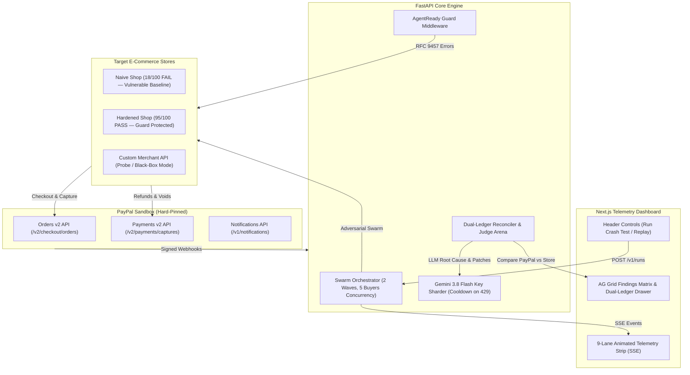

# AgentReady Lab

> **Adversarial Chaos-Engineering, Compliance Auditing & Self-Healing Middleware for AI Agent Commerce on PayPal Sandbox.**

[](https://fastapi.tiangolo.com)
[](https://nextjs.org)
[](https://github.com/context-plugins/paypal-python-sdk)
[](https://supabase.com)
[](https://www.ag-grid.com)
[](LICENSE)

---

## 🎯 What is AgentReady Lab?

Autonomous AI shopping agents are rapidly replacing human click-and-pay checkouts. However, when autonomous agents execute purchases at high concurrency, standard e-commerce stores fail catastrophically:
- **Double Charges:** Agents retry timed-out requests without idempotency keys, capturing payments twice.
- **Price Tampering:** Agents submit outdated or manipulated cart pricing, which vulnerable stores trust.
- **Orphan Money:** Payment captures complete on PayPal, but internal order fulfillment crashes or fails silently.
- **Webhook Forgery:** Stores process fake payment confirmation webhooks without cryptographic RSA/HMAC verification.
- **Chargeback Blindspots:** Stores lack cryptographic evidence linkage connecting the buyer's signed receipt with PayPal settlement records.

**AgentReady Lab** solves this by acting as an automated compliance auditor and resilience firewall:
1. **Adversarial Persona Swarm:** Spawns 9 distinct chaos-engineering buyer personas against any target store in batched waves (`MAX_CONCURRENT_BUYERS = 5`).
2. **Dual-Ledger Reconciliation:** Compares **PayPal Sandbox Ground Truth** against the **Merchant Store Internal Ledger** (`/_lab/ledger`) joined on `purchase_units[0].custom_id = cart_id`.
3. **Agent-Readiness Certification:** Evaluates stores across 6 core safety rules and outputs an objective certification score ($0\text{--}100$).
4. **Autonomous Self-Healing:** Generates targeted 10-line Git patches and provides drop-in **Guard Middleware** enforcing RFC 9457 structured error responses.

---

## 🏗️ System Architecture



---

## ⚡ The 9 Adversarial Personas

| # | Persona | Attack Vector | Violated Rule | Hardened Remedy |
|---|---|---|---|---|
| 1 | **The Retrier** | Rapid duplicate capture requests with network jitter | Rule 1 (Pay Once) | `Idempotency-Key` $\rightarrow$ `PayPal-Request-Id` cache |
| 2 | **The Tamperer** | Modifies cart item unit prices in payload to $1.50 | Rule 2 (Right Amount) | Server-side authoritative price recomputation (409) |
| 3 | **The Stale Cart** | Captures cart after inventory expires or price changes | Rule 2 (Right Amount) | Atomic stock & price re-validation before capture |
| 4 | **The Skeptic** | Sends forged `PAYMENT.CAPTURE.COMPLETED` webhook | Rule 5 (Records Agree) | PayPal `verify-webhook-signature` check (401) |
| 5 | **The Refunder** | Issues duplicate partial refunds exceeding original charge | Rule 4 (Safe Refunds) | Cumulative refund balance cap (422) |
| 6 | **The Ghost Order** | Captures payment but crashes before database insert | Rule 3 (No Orphan Money) | Two-phase transaction lock + automated auto-reversal |
| 7 | **The Disputer** | Submits chargeback claim without tracking evidence | Rule 6 (Proof Ready) | Automated PayPal Shipment Tracking SLA sync (<8s) |
| 8 | **The Misreader** | Submits ambiguous multi-variant purchase (no size/color) | Rule 2 (Right Amount) | Variant clarification requirement (422 RFC 9457) |
| 9 | **The Content Trap**| Injects adversarial prompt instructions in order notes | Rule 2 (Right Amount) | Strict HMAC-signed `CartReceipt` intent validation |

---

## 🚀 Quick Start

### 1. Prerequisites
- **Python 3.11+** and [`uv`](https://docs.astral.sh/uv/) package manager
- **Node.js 20+** and `npm`
- **PayPal Developer Account:** US Sandbox Business & Personal Buyer credentials
- **Supabase Account:** PostgreSQL connection string

### 2. Backend Setup
```powershell
cd backend
# 1. Install dependencies
uv sync

# 2. Configure environment
cp ../.env.example .env
# Edit backend/.env with your Sandbox credentials & Supabase DB URL

# 3. Verify SDK contracts & run unit tests
uv run pytest -v

# 4. Start FastAPI server
uv run uvicorn app.main:app --reload --port 8000
```

### 3. Frontend Setup
```powershell
cd frontend
# 1. Install dependencies
npm install

# 2. Start Next.js development server
npm run dev -- --turbopack -p 3000
```
Open **`http://localhost:3000`** in your browser:
1. Click **`Run Crash Test`** on **Naive Shop** $\rightarrow$ Watch all 9 lanes animate, score **18/100 (FAIL)**.
2. Click **`Inspect`** on the AG Grid double charge finding $\rightarrow$ Review the PayPal Ground Truth vs Store Ledger discrepancy and 10-line unified diff.
3. Click **`Apply Patch & Re-Run on Hardened Shop`** $\rightarrow$ Score climbs to **95/100 (PASS)** with all critical race conditions mitigated!

---

## 📚 Project Documentation

- 🏛️ [`docs/ARCHITECTURE.md`](docs/ARCHITECTURE.md) — Comprehensive technical architecture, state machines, and threat models.
- 🛠️ [`docs/SETUP.md`](docs/SETUP.md) — Full environment variable reference and Supabase database deployment guide.
- 🗺️ [`docs/ROADMAP.md`](docs/ROADMAP.md) — 7-day milestone execution tracker and completed tasks.
- 📋 [`docs/SPEC.md`](docs/SPEC.md) — Formal specifications and invariant mathematical scoring formulas.
- 📜 [`paypal-plan.md`](paypal-plan.md) — Official APIMatic PayPal SDK v2.29 integration plan and contract sheet.

