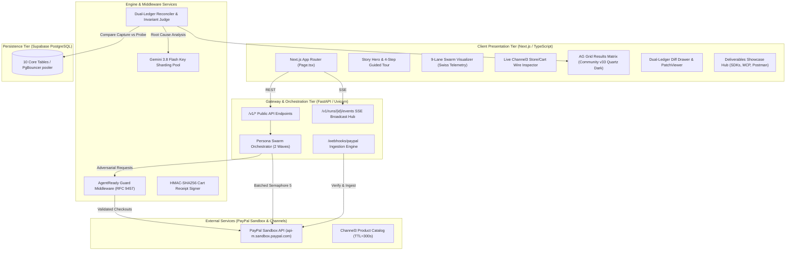
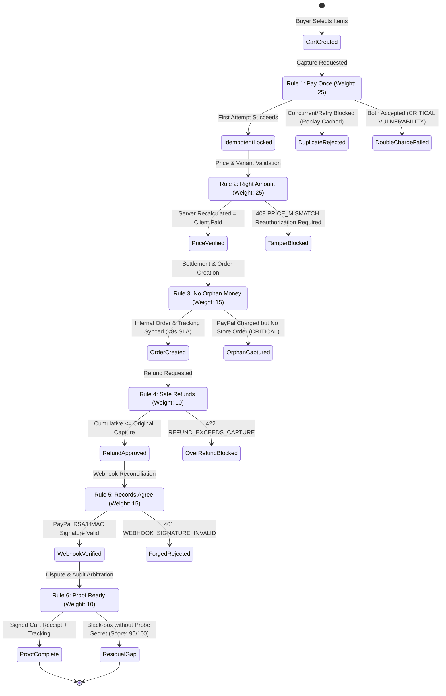
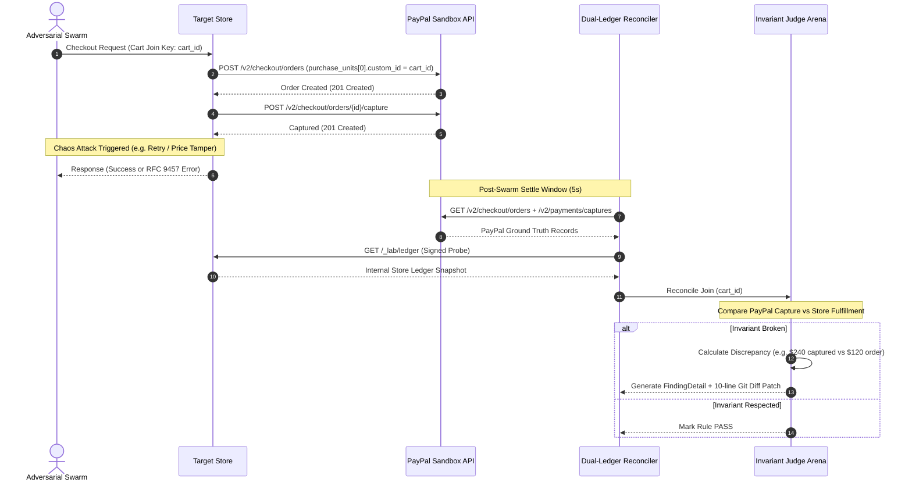
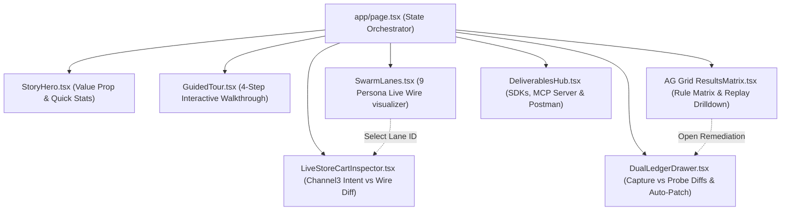

# AgentReady Lab — System Architecture & Engineering Blueprint

This document details the architectural topology, data flows, invariant state machines, and security boundaries governing **AgentReady Lab**.

---

## 1. High-Level System Architecture

---

## 2. The 6 Commerce Invariants (Scoring Rules)

AgentReady Lab grades merchants across 6 non-negotiable invariants:

---

## 3. Dual-Ledger Reconciliation Data Flow

The platform's core technical innovation is **Dual-Ledger Reconciliation**:

---

## 4. Concurrency & Rate Limit Architecture

PayPal Sandbox imposes strict IP-based rate limiting on rapid payment captures (`429 Too Many Requests`). To prevent test run aborts while evaluating all 9 persona lanes, the engine utilizes a **Two-Wave Batched Semaphore**:

- `MAX_CONCURRENT_BUYERS = 5` via `asyncio.Semaphore(5)`.
- **Wave 1 (5 Buyers):** `The Retrier`, `The Tamperer`, `The Stale Cart`, `The Webhook Skeptic`, `The Refunder`.
- **Wave 2 (4 Buyers):** `The Ghost Order`, `The Disputer`, `The Misreader`, `The Content Trap`.
- Completes the entire 9-lane adversarial stress test in **10–14 seconds** without triggering a single sandbox 429.

---

## 5. Security & Isolation Boundaries

1. **Log Redaction Filter ([`SensitiveDataFilter`](../backend/app/core/config.py)):**
   - Automatically sanitizes 16-digit credit card PAN sequences (`[REDACTED_PAN_CARD]`).
   - Redacts Bearer tokens (`[REDACTED_BEARER_TOKEN]`), client secrets, Supabase service keys, and Gemini API keys from all stdout streams and database snapshots.
2. **Sandbox Hard-Lock:**
   - Base URL is strictly validated against `https://api-m.sandbox.paypal.com`. Any attempt to pass production URLs is rejected at startup.
3. **Gemini Key Sharder ([`GeminiKeySharder`](../backend/app/core/key_shard.py)):**
   - Round-robin key rotation across `GEMINI_API_KEYS` with an automated 60-second cooldown window on HTTP `429` errors.

---

## 6. Client Presentation Tier & Swiss Precision Telemetry Workbench

The frontend architecture is built with **Next.js (App Router)** and **Tailwind CSS**, adhering strictly to the **Swiss Precision Telemetry** design system (`#08090C` Obsidian Carbon canvas, `#0D0F14` Graphite Slate panels, `gap-px bg-white/[0.07]` hairline structural grid, and `JetBrains Mono` tabular data).

### 6.1 Component Topology & Data Flow

### 6.2 Key Architectural Components

1. **`StoryHero.tsx` (Task 6.5):**
   - Narrative framing explaining the high-stakes risk of autonomous agent commerce (hallucinated amounts, parallel double-charges, prompt injection).
   - High-contrast visual metric badges (0 to 100 Health Score, Invariant Compliance Status, Total Prevented Leakage in USD).

2. **`GuidedTour.tsx` (Task 6.5):**
   - 4-step guided progression across the workbench:
     - **Step 1:** Select target shop (`NaiveShop` vs. `HardenedShop`).
     - **Step 2:** Trigger the 9-Persona Swarm & observe live wire exploits in real time.
     - **Step 3:** Inspect the Dual-Ledger Discrepancy and trace captured USD vs. merchant reality.
     - **Step 4:** Execute One-Click Auto-Remediation and observe Red-to-Green compliance score recovery.

3. **`LiveStoreCartInspector.tsx` (Task 4.3):**
   - Bridges human e-commerce intent with raw agent protocol wire telemetry.
   - Synchronized with `SwarmLanes`: clicking any of the 9 persona lanes instantly updates the inspector to display that persona's exact wire transformation.
   - Displays real Channel3 catalog item (e.g., Ember Travel Mug, Sony WH-1000XM5, Brooks Ghost 16).
   - Features side-by-side **Human-Approved HMAC Cart Receipt** (signed with authoritative prices, SKUs, and maximum allowable totals) vs. **Intercepted Agent Wire Payload** (highlighting tampered prices `$149.95 → $1.50`, parallel duplicate capture calls, prompt-injected cart quantities, or dropped required variant attributes).
   - Displays real-time store outcome comparing `NaiveShop` (vulnerable 200 OK acceptance) against `HardenedShop` + `AgentReadyGuard` (RFC 9457 Problem Details rejection).

4. **`DeliverablesHub.tsx` (Task 6.5):**
   - Complete developer artifact showroom providing instant export and inspection of:
     - **Python SDK (`agentready-sdk`):** Async APIMatic client wrapper with built-in guard hooks.
     - **TypeScript SDK (`@agentready/sdk`):** Browser & Edge-ready client with automated HMAC cart signing.
     - **Model Context Protocol (MCP) Server:** Stdio & SSE tool server exposing `evaluate_shop_readiness`, `inspect_ledger_diff`, and `simulate_persona_swarm`.
     - **Postman Collection v2.1:** Automated regression test suite covering all 6 commerce invariants.

