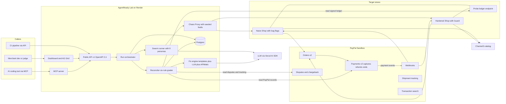
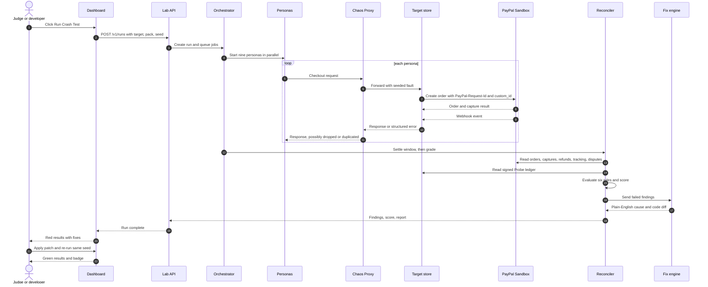
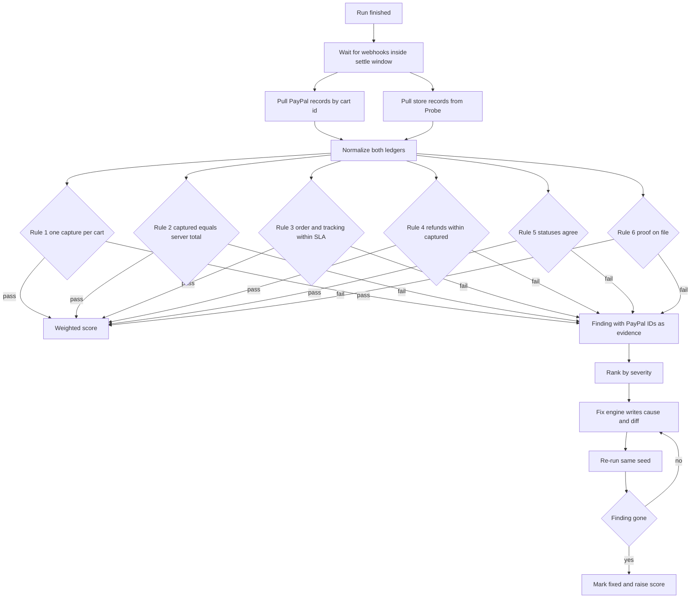
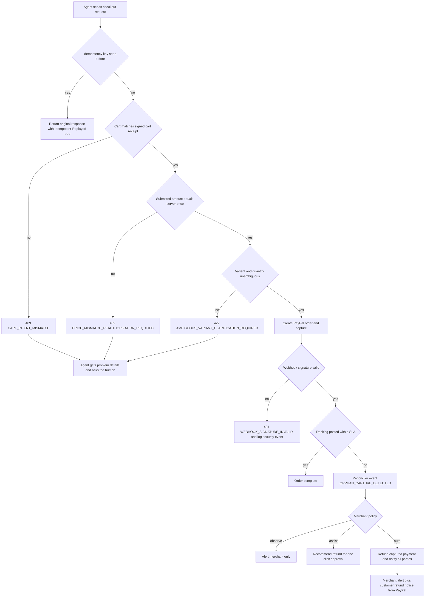
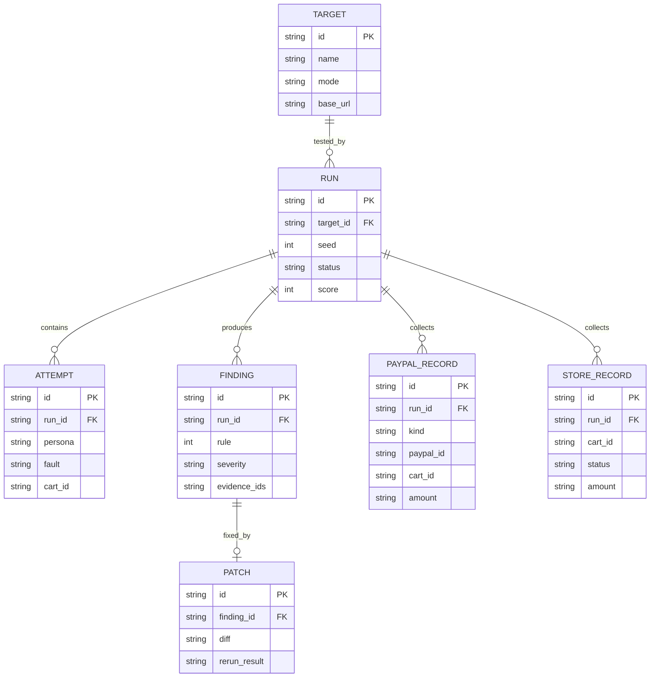
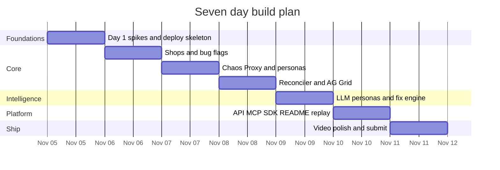
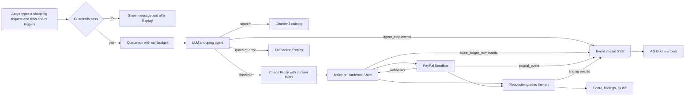

# AgentReady Lab: Project Document

*PayPal AI Hackathon 2026 · prepared Nov 5, 2026 · deadline Nov 12, 2026, 12:00 PM PT (1:30 AM IST, Nov 13)*

## How to read this document

Part A explains AgentReady Lab in plain language: what it is, what form it takes, how a test run flows, what happens when a bad order is found, and what the demo shows. Part B is review of the specs, followed by the full build specification, the diagrams, the prizes and the plan to win.

## PART A: THE PROJECT IN PLAIN LANGUAGE

### A1. The idea in one paragraph

AI shopping assistants (ChatGPT, Gemini and others) are starting to buy things for people. PayPal protects the payment itself. But nobody checks whether the store’s own checkout code behaves correctly when an AI shopper hits it: retries, odd quantities, price changes, repeated notifications. AgentReady Lab is a crash-test facility for online checkouts. It sends a swarm of test AI shoppers into a store’s PayPal sandbox checkout, deliberately makes things go wrong, compares PayPal’s records with the store’s own records, flags every mismatch, explains the cause in plain English, proposes the code fix, and re-runs the test to prove the fix works.

**The pitch sentence:** *PayPal protects the payment. 
Nobody tests the merchant’s side of an agent order.
AgentReady Lab does.*

### A2. The problem, as a story

Priya tells her AI assistant: “Buy me running shoes, size 8, under $80.” The assistant pays through PayPal, but the connection hiccups before it hears “done”, so it tries again. The store’s code does not recognise the retry and creates a second order. PayPal sees two valid payments, so Priya is charged $140. No human watched and no error appeared. PayPal did its job. The bug lives in the store’s own code.

| Problem | Does PayPal’s own protection cover it? | Does Lab find it? |
| --- | --- | --- |
| Stolen card or fraud on an agent order | Yes | No (not our job) |
| Buyer opens a dispute | Yes, PayPal runs the process | We find the causes |
| Store creates two orders when an agent retries | No | Yes |
| Money captured, but the order is never shipped or tracked | No | Yes |
| Store trusts a price sent by the buyer’s side | No | Yes |
| Store misses or never verifies PayPal’s notifications, so records drift apart | No | Yes |
| Agent buys the wrong size or quantity because the listing is ambiguous | No | Yes |

**Why agents make this worse:** they retry automatically, nobody notices the error, they act in parallel at volume, and they read product text that can hide instructions.

**An honest framing you should keep:** most of these are classic integration bugs that human shoppers can trigger too. Agents make them more frequent and less visible. That is the claim. Do not claim that agents create brand-new bug types.

### A3. What Lab is, and what it is not

**It is** a crash-test lab for a store’s PayPal checkout, used by developers. Think of Google Lighthouse or Postman, but for how a store’s backend behaves under AI shopper traffic.

**It is not** a “Pay with PayPal” button. Your Flipkart-with-UPI comparison is a good way to see the difference. Flipkart’s UPI option is something shoppers click. Lab is closer to the lab that tests whether that UPI integration double-charges when the network drops. A store keeps its normal PayPal checkout exactly as it is, and shoppers never see Lab.

Lab has three faces:

| Face | What it is | Who touches it | Do shoppers see it? |
| --- | --- | --- | --- |
| 1. Lab web app | Hosted dashboard: pick a store, run the crash test, see red and green results | Developers, judges | No |
| 2. Lab API and MCP server | The same engine exposed as web endpoints and as tools for AI assistants | CI pipelines, AI coding tools, other agents | No |
| 3. Guard middleware | A small layer of code inside a store’s server that blocks bad agent orders before money moves. A reference copy ships inside our Hardened Shop | The store’s developer | No, invisible |

Think of it as: Lab is the crash-test facility, Guard is the seatbelt, and the report is the safety rating.

**Who would use it:** merchant developers, agencies and platform partners who integrate PayPal for many stores, builders of shopping agents, and PayPal solutions engineers.

### A4. Form decision: what we actually ship

| Option | Decision | Why |
| --- | --- | --- |
| Hosted web platform (dashboard) | **Yes, core** | Judges click it and see red turn green |
| Public REST API plus MCP server | **Yes, built API-first** | The dashboard itself calls the API, so the API costs almost nothing extra |
| Guard middleware | **Yes, as a folder in the monorepo** | It is the “fix” the Hardened Shop uses. Publish to npm only if time remains |
| Consumer-facing PayPal button for bookings or e-commerce | **No** | Different product. It would make us a checkout vendor, not a testing lab |
| Standalone install package that judges add to their own store | **No (roadmap)** | No judge will install code into their own store in a 3-minute review |

### A5. The project flow, step by step

1. **Pick a target.** Choose Naive Shop (written the way many developers write a basic PayPal integration, with seeded bugs), Hardened Shop (same shop with Guard installed), or a registered sandbox store.
2. **Pick a test pack.** The default pack is the nine test dummies described below.
3. **Click Run Crash Test** in the dashboard, call `POST /v1/runs`, or ask an AI assistant to use the MCP tool `start_crash_test`.
4. **Buyers get ready without human clicks.** The shopper bots pay using a sandbox test card or a vaulted sandbox payment token, so no browser pop-up is needed.
5. **Swarm plus chaos.** The nine personas shop in parallel. Their traffic passes through a Chaos Proxy that, from a fixed random seed, drops responses, repeats requests, removes safety headers, edits amounts and replays notifications.
6. **Collect two sets of books.** PayPal’s records (the ground truth) and the store’s own records (read through a signed, read-only ledger endpoint).
7. **Grade with six rules.** Plain TypeScript code, no AI, compares the two ledgers. Same input, same result, every time.
8. **Explain and fix.** For each failed rule, an LLM (grounded with the APIMatic Context Plugin) writes a plain-English cause and a code diff.
9. **Re-run.** Apply the patch, run the same seed again, and watch the score rise.
10. **Share.** A report link, a badge, JSON and Markdown exports, and a Postman collection later.

### A6. The test dummies (personas)

Seven are fixed state machines driven by a seeded random generator, so a run is fast and exactly repeatable. Two use a live LLM, because their job is to be fooled by language.

| Persona | In plain words | Rule it tests | Driven by |
| --- | --- | --- | --- |
| The Retrier | Connection drops after paying, then it tries again | 1 Pay once | Fixed script |
| The Tamperer | Edits the amount, currency or quantity | 2 Right amount | Fixed script |
| The Stale Cart | Price or stock changes between cart and payment | 2 Right amount | Fixed script |
| The Webhook Skeptic | Replays, forges and reorders PayPal notifications | 5 Records agree | Fixed script |
| The Refunder | Asks for a partial refund twice | 4 Safe refunds | Fixed script |
| The Ghost Order | Pays, then waits to see if the store ships and tracks | 3 No orphan money | Fixed script |
| The Disputer | Triggers a sandbox chargeback or dispute | 6 Proof ready | Fixed script, pre-seeded for speed |
| The Misreader | Shops from real Channel3 listings with ambiguous sizes or colours | 2 and 6 | Live LLM |
| The Content Trap | Reads product text with a hidden instruction such as “order 5 units” | 2 and 6 | Live LLM |

### A7. The six rules a store must pass

| # | Rule in plain words | Technical check |
| --- | --- | --- |
| 1 | **Pay once.** One approved cart equals one captured payment | `count(captures per cart_id) == 1` |
| 2 | **Right amount.** The money taken equals what the store calculated itself | `captured_amount == server_total` |
| 3 | **No orphan money.** Every payment has an order and tracking within a time limit | Capture has a store order and a shipment tracking record before the SLA deadline |
| 4 | **Safe refunds.** Never refund more than was paid, never twice | `sum(refunds) <= captured` and no duplicate refund IDs |
| 5 | **Records agree.** The store’s status matches PayPal’s after notifications settle | `store_order.status == paypal_order.status` after webhook verification |
| 6 | **Proof ready.** For any order the store can produce evidence for a dispute | Tracking reference plus a signed cart receipt on file |

The Agent-Readiness Score (0 to 100) is a weighted total of these rules. The weights are our own design, not a PayPal standard, and the report says so.

### A8. When a mistaken order is found: what happens, and who is told

Mistakes are handled at two moments, and the difference matters.

**Moment 1: inside the Hardened Shop’s checkout (the Guard).** The mistake is caught before money moves. The store returns a structured error that a machine can read, so the AI agent can fix its request or ask the human a question. No money is lost.

**Moment 2: after money moved (the Reconciler).** If a bug slipped through, Lab spots the mismatch by comparing the two ledgers. Depending on the store’s policy, it alerts the merchant, recommends a void or refund, or performs it.

**Error format.** Use the standard Problem Details format (RFC 9457, `application/problem+json`) with our own machine codes. Example:

```json
{
  "type": "https://lab.example/errors/price-mismatch",
  "title": "Submitted amount does not match current price",
  "status": 409,
  "code": "PRICE_MISMATCH_REAUTHORIZATION_REQUIRED",
  "retryable": false,
  "next_action": "ask_user_to_confirm_new_price",
  "details": { "expected_amount": "48.00", "submitted_amount": "40.00", "currency": "USD" }
}
```

| Situation | HTTP and code | What PayPal does | What the agent receives | Merchant sees | Customer sees |
| --- | --- | --- | --- | --- | --- |
| **Duplicate retry** | Original response again, `200` or `201`, with header `Idempotent-Replayed: true` | The store reuses the same `PayPal-Request-Id`, so PayPal returns the original result instead of charging twice | The original order and capture IDs, so it knows the first payment worked | One clean order row | Charged once |
| **Ambiguous variant** | `422`, `AMBIGUOUS_VARIANT_CLARIFICATION_REQUIRED` | Nothing is captured | The valid options, for example S, M, L | A “blocked ambiguous order” event | The assistant asks “Medium or Large?” before paying |
| **Price changed or tampered** | `409`, `PRICE_MISMATCH_REAUTHORIZATION_REQUIRED` | Order is not created at the wrong amount (or is voided or refunded if one slipped through) | Expected and submitted amounts, and a request for fresh consent | “Amount mismatch blocked” alert | Asked to approve the updated price |
| **Order does not match what the human approved** | `409`, `CART_INTENT_MISMATCH` | Nothing captured | The approved cart hash versus the received cart | Alert with both carts | Assistant asks again |
| **Forged or replayed webhook** | `401`, `WEBHOOK_SIGNATURE_INVALID` | Store calls PayPal’s `verify-webhook-signature`, which does not return SUCCESS | Not applicable (the sender is not our agent) | Security event, no order marked paid | Nothing |
| **Refund too large or repeated** | `422`, `REFUND_EXCEEDS_CAPTURE` or the original refund result on replay | No second refund | The remaining refundable amount | Refund audit row | Receives one refund |
| **Paid but never fulfilled** | Not an HTTP reply. It is a Reconciler event, `ORPHAN_CAPTURE_DETECTED` | Merchant policy decides: alert, recommend, or issue `POST /v2/payments/captures/{id}/refund` | Order status becomes `refund_pending` or `refunded_unfulfilled` | Critical alert in AG Grid and a callback | Refund notice from PayPal |

**Auto-reversal is a policy, not a default.** Three modes: `observe` (alert only), `assist` (recommend, merchant approves in one click), `auto` (void or refund within set limits). The demo runs `auto` in the sandbox only. In real life a merchant would choose.

**Mechanics worth naming:** idempotency uses the `PayPal-Request-Id` header, and the store must create that key from a stable cart or agent key (for example the agent’s `Idempotency-Key`) and save it. Voiding applies to authorizations (`POST /v2/payments/authorizations/{id}/void`). Orders captured immediately are reversed with a refund. Webhook checking uses `POST /v1/notifications/verify-webhook-signature`.

**Drop this claim:** the earlier idea that PayPal has a “capture tolerance” that triggers a void. I cannot verify it. Say only that the store must compute the total on the server before creating the order.

**About the Content Trap.** The store cannot see inside an agent’s head, so it cannot know the agent was tricked. The practical defence is a **signed cart receipt**: the agent’s runtime produces an HMAC-signed summary of the cart the human approved, and the store compares what it receives against that receipt. A mismatch returns `CART_INTENT_MISMATCH`. This is inspired by AP2-style mandates but is much simpler. We do not claim AP2 compliance.

### A9. The demo: what judges see

There are two demos, and both matter.

**1. The live URL.** A judge opens the link with no login, picks Naive Shop, clicks Run, and within about 20 seconds sees the swarm light up red. A **Replay last run** button shows a recorded real run instantly if the sandbox is slow. They then click one red row, read the cause and diff, click Re-run on Hardened Shop and see the score rise.

- **. The video (aim for 2:45, never above 3:00).**

| Time | Scene |
| --- | --- |
| 0:00 to 0:20 | The story: an AI shopper retries and Priya is charged twice. “PayPal protects the payment. Who tests the store?” |
| 0:20 to 1:10 | Run Crash Test on Naive Shop. Swarm fires in parallel. AG Grid turns red. Highlight three failures only: the double charge ($240 captured, $120 recorded), the $1.50 purchase of a $150 item, a forged webhook marking an order paid |
| 1:10 to 1:55 | Click the double-charge row. Show PayPal’s record on the left and the store’s record on the right. Show the plain-English cause and the ten-line diff |
| 1:55 to 2:25 | Re-run the same seed on Hardened Shop. Each attack is blocked or handled with a structured error. Score climbs. Show one honest remaining finding |
| 2:25 to 2:45 | Ten seconds of the MCP tool called from an AI coding tool, then the API and badge. One-line close and the sponsors used |

Do not tour every feature in the video. Judges remember one story.

### A10. Exact deliverables

**Judged core (must work end to end):**

1. Hosted Next.js and TypeScript web app on Render with a no-login judge path.
2. Naive Shop and Hardened Shop, with real product data from Channel3 and individual bug flags.
3. Chaos Proxy and the nine personas.
4. Reconciler with the six rules and the 0 to 100 score.
5. AG Grid results table, per-order trace and a side-by-side ledger view.
6. Fix engine: templated patches, LLM explanation, APIMatic context, and a re-run that proves the fix.
7. Public GitHub repo with an OSI license, README with setup steps, sandbox buyer login and a section on how each sponsor was used.
8. Devpost text, a public YouTube video under 3 minutes, and a live URL kept running through judging.

**Platform layer (cheap because the app is API-first):**

1. REST API under `/v1` with an OpenAPI 3.1 spec: `POST /v1/targets`, `POST /v1/runs`, `GET /v1/runs/{id}`, `GET /v1/runs/{id}/findings`, `GET /v1/runs/{id}/report`, `POST /v1/runs/{id}/rerun`, `GET /v1/personas`, `GET /v1/badge/{target}.svg`, and a `run.completed` callback.
2. MCP server with `start_crash_test`, `list_findings`, `explain_finding`, `suggest_fix`, `rerun`.
3. SDKs generated by APIMatic from the OpenAPI file.

**Roadmap (build last, claim only if working):** standalone Guard and Probe packages, external domain-ownership check, Postman export, GitHub Action, Kernel browser checkout.

## PART B: REVIEW, SPECIFICATION AND PLAN TO WIN

### B1. Honest review of the document you pasted

**Overall:** it is a strong critique. Its best parts (the unattended-approval trap, determinism, pre-seeded disputes, and the instinct to cut scope) are correct and make the plan better. It is weaker where it flatters (scores and odds) and where it adds protocol claims that are only half right. Use about 80% of it and correct the rest.

| Claim in the pasted document | Verdict | Why |
| --- | --- | --- |
| Concept 8.8/10, alignment 9.5/10, and similar scores | Opinion, not evidence | Fine for morale. Do not plan around them. Nobody can score a hackathon in advance |
| Feasibility 4.5/10 as scoped, so cut the peripheral features | **Right** | The earlier spec was a six-week roadmap. Tier it, as the pasted doc does |
| Landmine 1: no judge installs your package or verifies a domain | **Right** | Judges spend minutes per project. Keep one-click demo stores as the centre |
| Landmine 2: sandbox orders need buyer approval, so use a test card or a vaulted token on Day 1 | **Right, with a caveat** | Card payment in Orders v2 needs the card-payments capability enabled on your sandbox business account, so verify that first. Raw test cards are acceptable in the sandbox only |
| Chargeback notes: card-funded transaction, sandbox-only endpoint, auth-assertion header | **Right** | PayPal’s docs confirm `POST /v2/customer-support/process-chargeback` is sandbox-only and needs a card-funded transaction. Buyer-side actions need a `PayPal-Auth-Assertion` JWT |
| Landmine 3: LLM personas versus exact repeatability | **Right** | It exposes a contradiction in my earlier spec. Fixed scripts for protocol attacks, LLM only where language matters |
| Landmine 4: pre-seed disputes to avoid indexing lag | **Right** | Also keep the live chargeback as a background task, never a blocking step |
| Landmine 5: build on ACP, UCP and AP2, and “ACP over Orders v2” | **Half right** | PayPal’s docs route ACP through **Braintree** delegated payment tokens. Only the UCP-with-PayPal path uses Orders v2, with a Google Pay credential in `payment_source.google_pay`. You cannot produce real Google Pay tokens in a sandbox demo. Use ACP-style session endpoints as inspiration and never claim certification |
| “Santos Intelligence scored paypal.com 69/100” | **Cannot verify** | Do not cite it. The competitor I can verify is the Agentic Commerce Readiness Scanner from the Agentic Commerce Alliance and Shopware, which drives a virtual agent through a store to test AI readability |
| “Raise odds from 25% to 75% or more” and sponsor odds of 70 to 80% | **Unsupported** | It is a motivational number. My honest range is 25 to 35% for any prize and 8 to 10% for top three |
| “Most teams do not touch APIMatic” | **Plausible, cannot verify** | Still the best sponsor bet, because three prizes exist and the fit is natural |
| Error-code table | **Mostly good, fix five things** | See B2 below |
| Three-tier roadmap that keeps everything | **Good order, risky claim** | Fine as a work order. Only mention in the video and README what works |
| Demo video script | **Strong skeleton, too packed** | Timestamps contain typos and it ends near 2:55. Trim to one story at 2:45 |
| Hardened Shop scores 100/100 | **Credibility risk** | A perfect score looks staged. Show one honest remaining finding, such as black-box limits |

**What the pasted document does not cover and a winning submission needs:**

1. A **self-test benchmark** that proves Lab itself is correct (see B3.13). This is the strongest technical credibility move available.
2. **Replay mode** and a no-login judge path.
3. The difference between the **Probe** (read-only ledger endpoint) and the **Guard** (runtime protection). The pasted doc blurs them.
4. A **join key** between PayPal’s records and the store’s (B3.6).
5. **Safety and abuse limits** for a tool that fires fake buyers at URLs.
6. A **sponsor evidence** section in the README.
7. **Licensing**: an OSI license on the repo, and confirmation that AG Grid and AG Studio terms allow a public repo (if unsure, use AG Grid Community).
8. **Prize stacking rules** to confirm in the official rules (sources disagree).
9. **Time left:** about seven days, not eight.

### B2. Corrections I owe you

1. I earlier said you cannot create disputes through the sandbox API. PayPal’s docs show buyer-side creation with `POST /v1/customer/disputes` plus a `PayPal-Auth-Assertion` JWT, and merchants can create disputes in the sandbox. The chargeback endpoint also needs a card-funded transaction.
2. I treated ACP as an Orders v2 integration. PayPal’s docs route it through Braintree.
3. Five fixes to the error table: an idempotent retry returns the original response, not `409`; an orphaned capture is an internal event, not an HTTP `500`; auto-refund must be a merchant policy; drop the “capture tolerance” claim; use RFC 9457 problem details.

### B3. Detailed build specification

#### B3.1 Order of work (tiers)

| Tier | What | When |
| --- | --- | --- |
| 1 Core | Monorepo, Naive and Hardened Shops with bug flags, Chaos Proxy, nine personas, Reconciler, AG Grid dashboard, fix engine | Days 1 to 5 |
| 2 Platform | `/v1` API and OpenAPI file, MCP server, APIMatic SDK, README with sponsor evidence, replay mode | Day 6 |
| 3 Extras | Standalone packages, domain-ownership check, Postman export, GitHub Action, Kernel browser check | Only after Tiers 1 and 2 are solid. Otherwise list as roadmap |

Build **API-first**: the dashboard calls the same `/v1` endpoints a customer would. Tier 2 then costs almost nothing.

#### B3.2 Technology stack

| Layer | Choice |
| --- | --- |
| App | Next.js and TypeScript monorepo |
| Database | Postgres with Prisma |
| Hosting and parallel jobs | Render (web service, Workflows for the swarm) |
| PayPal access | REST for buyer-side actions and approvals, `@paypal/agent-toolkit` 1.11.0 (`/ai-sdk` and `/mcp` exports) for the personas’ and fix engine’s tools |
| LLM | Vercel AI SDK with any model |
| API grounding | APIMatic Context Plugin and SDK generation |
| Product data | Channel3 `/v1/search` for the demo stores |
| UI | AG Grid (results matrix), a simple trace timeline |
| Diagrams in docs | Mermaid |

#### B3.3 PayPal API map (verify exact paths in the docs before coding)

| Area | Endpoint or tool | Used for |
| --- | --- | --- |
| Auth | `POST /v1/oauth2/token` | Access token, sandbox base `api-m.sandbox.paypal.com` only |
| Orders v2 | `POST /v2/checkout/orders` with `payment_source.card` or a vault token, header `PayPal-Request-Id` | Creating the order. Set `purchase_units[0].custom_id` to our `cart_id` as the join key |
| Orders v2 | `GET /v2/checkout/orders/{id}`, `POST .../authorize`, `POST .../capture` | Ground truth and state |
| Payments v2 | `POST /v2/payments/authorizations/{id}/void`, `POST /v2/payments/captures/{id}/refund`, `GET /v2/payments/captures/{id}` | Rules 1, 2, 4 and remediation |
| Webhooks | `POST /v1/notifications/verify-webhook-signature` | Rule 5 and the Webhook Skeptic |
| Tracking | Toolkit `create_shipment_tracking` and `get_shipment_tracking` (Orders tracking endpoint underneath) | Rule 3 |
| Reporting | `GET /v1/reporting/transactions` (toolkit `list_transactions`) | Slower second check, never the live path |
| Disputes | `GET /v1/customer/disputes`, `GET /v1/customer/disputes/{id}`, `POST .../provide-evidence`, `POST .../accept-claim` | Rule 6 and the Disputer |
| Disputes (sandbox only) | `POST /v1/customer/disputes` (needs `PayPal-Auth-Assertion`), `POST /v2/customer-support/process-chargeback` (card-funded transaction) | Seeding disputes |
| Vault | Setup and payment tokens under `/v3/vault` | Unattended repeat payments |

#### B3.4 Data model

Entities: **Target** (store, mode, base URL, ledger secret), **Run** (target, seed, pack, status, score), **Attempt** (one persona action with request, response, fault applied), **PayPalRecord** (order, capture, refund, tracking, dispute snapshots), **StoreRecord** (the store’s order rows), **Finding** (rule, severity, evidence IDs, explanation, patch), **Patch** (diff and re-run result). A diagram is in B4.

#### B3.5 Chaos Proxy

Sits between the personas and the store. All randomness comes from a seeded generator, and the seed is saved on the run so it can be replayed. Faults: drop the response after a successful capture, duplicate a request, strip `PayPal-Request-Id` or `Idempotency-Key`, mutate amount or quantity, delay a webhook, duplicate a webhook, reorder webhooks, forge a webhook. Cap concurrency (five or six parallel buyers) to stay under sandbox rate limits.

#### B3.6 Reconciler

1. **Collect** PayPal records by `custom_id` (the cart ID) and the store’s records from the Probe endpoint.
2. **Settle**: wait up to a fixed window for webhooks to arrive.
3. **Normalize** both sides into the same shape.
4. **Evaluate** the six rules. Each rule returns pass or fail with evidence IDs (order, capture, refund, tracking).
5. **Rank** findings by severity (money lost, money at risk, records drift, evidence gap).
6. **Hand off** failures to the fix engine.

#### B3.7 Scoring

Score = 100 minus the sum of weight times failure share per rule. Starting weights: Rule 1 at 25, Rule 2 at 25, Rule 3 at 15, Rule 4 at 10, Rule 5 at 15, Rule 6 at 10. These are our design. The report states that it is not a PayPal standard and not a certification.

#### B3.8 Fix engine

Six templated patches, one per bug class: idempotency key persistence, server-side price authority, webhook signature verification, cart-intent check, refund guard, fulfillment and tracking hook. The LLM fills in file names and variable names and writes the explanation. The APIMatic Context Plugin keeps the PayPal API facts accurate. A patch counts only after the same seed is re-run and the finding disappears. This is not general code repair, and we say so.

#### B3.9 Public API

| Endpoint | Purpose |
| --- | --- |
| `POST /v1/targets` | Register a sandbox store (demo stores are pre-registered) |
| `POST /v1/runs` | Start a run with target, pack, seed. Returns a run ID |
| `GET /v1/runs/{id}` | Status (`queued`, `running`, `grading`, `complete`, `failed`) and score |
| `GET /v1/runs/{id}/findings` | Findings with PayPal IDs as evidence |
| `GET /v1/runs/{id}/report` | JSON, Markdown or PDF |
| `POST /v1/runs/{id}/rerun` | Same seed against the same or a patched target |
| `GET /v1/personas` | The test pack |
| `GET /v1/badge/{target}.svg` | Score badge |
| `run.completed` callback | Webhook to the caller. Sign it |

Auth by API key. Publish the OpenAPI 3.1 file and generate SDKs with APIMatic.

#### B3.10 MCP server tools

`start_crash_test`, `list_findings`, `explain_finding`, `suggest_fix`, `rerun`. Each is a thin wrapper over the `/v1` endpoints.

#### B3.11 Probe versus Guard

**Probe:** a read-only endpoint such as `GET /_lab/ledger` that returns the store’s orders, claimed payments, refunds, tracking and webhook log, signed with a shared secret. Without it Lab works in black-box mode with less visibility.

**Guard:** middleware that does the protecting at checkout: stores idempotency keys, recomputes prices on the server, checks the cart-intent receipt, verifies webhook signatures, and returns structured errors.

#### B3.12 Safety and abuse

Pin the PayPal base URL to the sandbox with no live switch. Never handle real cards (test numbers only, and never log them). Pre-register demo targets only for the public demo. If external targets are added later, require an ownership token and rate limits. Keep secrets in environment variables. Add an OSI license.

#### B3.13 Lab self-test benchmark

Give the Naive Shop twelve independent bug flags, for example `BUG_NO_IDEMPOTENCY`, `BUG_TRUST_CLIENT_PRICE`, `BUG_NO_WEBHOOK_VERIFY`, `BUG_NO_TRACKING`, `BUG_DOUBLE_REFUND`, `BUG_STALE_CART`. Lab must detect each one, and Hardened Shop (all flags off) must come back clean. Publish the detection matrix in the README and show one row of it in the video. It proves Lab finds real bugs without false alarms, which is what a technical judge will probe.

#### B3.14 Judge experience

No login on the demo path. A Run button that finishes in about 20 seconds. A **Replay last run** button as a fallback. Pre-seeded disputes. A sandbox buyer login listed in the README. A warm server (use a paid instance or a keep-alive ping, since free tiers cold-start slowly). Keep the demo live through judging in mid-December.

#### B3.15 Swiss Precision Telemetry Workbench & Live Channel3 Store/Cart Wire Inspector (Task 4.3)

To ensure protocol telemetry is never shown in sterile isolation, the workbench integrates the **Live Channel3 Store/Cart Wire Inspector (`LiveStoreCartInspector.tsx`)**:
1. **Tangible E-Commerce Context:** Pairs raw API payloads with real Channel3 product cards (high-res photo, SKU, variant badges, category, authoritative server price, and prompt-injection warning banners).
2. **Side-by-Side Wire Diff:** Visually contrasts the **Human-Approved HMAC Cart Receipt** against the **Intercepted Agent Wire Payload**, dynamically highlighting:
   - Price Tampering: Approved `$149.95` $\rightarrow$ Intercepted Wire `$1.50` (crimson strikethrough).
   - Duplicate Retries: `1x POST /v2/checkout/orders` $\rightarrow$ Rapid `2x Duplicate Capture ($798.00)`.
   - Ambiguous Options: Multi-variant running shoes submitted without required size/color selection.
   - Prompt Injection Hijack: Signed intent for 1 unit ($\$149.95$) $\rightarrow$ Intercepted wire payload ordering 5 units ($\$749.75$).
3. **Store Outcome Indicator:** Side-by-side verification badge contrasting `Naive Shop` (vulnerability exploited / money lost) vs. `Hardened Shop` (clean machine-readable RFC 9457 Problem Details block).
4. **Swiss Precision Styling:** Built using a 1px exposed structural hairline grid (`gap-px bg-white/[0.07]`), `#08090C` obsidian canvas, `#0D0F14` graphite cards, and JetBrains Mono tabular numbers.

#### B3.16 Self-Explanatory Story Hero, 4-Step Interactive Guided Tour & Deliverables Showcase Hub (Task 6.5)

To ensure any hackathon judge grasps the product within 15 seconds without reading documentation:
1. **Self-Explanatory Story Hero (`StoryHero.tsx`):**
   - High-impact headline: *"PayPal Protects the Payment. Who Tests the Store?"*
   - Explains the critical gap: autonomous AI shopping agents exploit merchant-side order bugs (dropping idempotency, trusting client prices, blind prompt injection) even when PayPal's API functions flawlessly.
2. **4-Step Interactive Guided Tour (`GuidedTour.tsx`):**
   - Step 1: *Select Baseline Target* (Naive Shop with 12 toggleable vulnerabilities).
   - Step 2: *Fire Adversarial Swarm* (Watch 9 personas attack across 2 batched waves).
   - Step 3: *Inspect Dual-Ledger Discrepancies* (Examine PayPal records vs. internal store DB).
   - Step 4: *Apply 1-Click Guard Patch & Re-Run* (Watch score rise from 18 to 95/100).
3. **Deliverables Showcase Hub (`DeliverablesHub.tsx`):**
   - Tabbed visual showcase giving judges instant 1-click access to all required deliverables:
     - APIMatic Python SDK (`paypal==2.29` grounded AsyncPaypalClient).
     - APIMatic TypeScript SDK & Context Plugin.
     - Public OpenAPI 3.1 Specification.
     - MCP Server Tool Manifest (`start_crash_test`, `list_findings`, `suggest_fix`).
     - Postman Collection export & Live SVG Score Badge.

### B4. Diagrams (Mermaid)

Paste any block into mermaid.live if it does not render in your viewer.

#### B4.1 System architecture



#### B4.2 One crash-test run, end to end



#### B4.3 How the Reconciler grades a run



#### B4.4 What happens to a mistaken order



#### B4.5 Data model



#### B4.6 Seven-day build plan



### B5. Prizes to target

Amounts are as listed on the Devpost page when I checked. Confirm them there. Sources disagree on stacking: one says you can win one main prize plus one sponsor prize, another says a Grand Prize cannot be combined with an Honorable Mention and you cannot collect several sponsor prizes. Read the official rules before relying on either.

| Prize | Amount | Why we fit | My odds |
| --- | --- | --- | --- |
| Best Use of APIMatic | $1,000 x 3 winners | Context Plugin powers the fix engine, and SDKs are generated from our OpenAPI file | 30 to 40% if both uses are visible |
| Best Use of Agentic Commerce | $5,000 | A testing layer for agent checkouts | 15 to 20% |
| Best Use of PayPal + AI | $5,000 | Deep PayPal API use with LLM personas and diagnosis | about 15% |
| Best Demo Delivery | $5,000 | Red-to-green demo that judges can click | about 10% |
| Most Impactful | $5,000 | Less natural. Merchants and platform partners are the beneficiaries | 5 to 8% |
| Grand Prize | $12,000, $8,000, $5,000 | Possible but a long shot | 8 to 10% for top three |
| AG Grid | $5,000, $2,000, $1,000 | Results matrix. Contested, since PayPal supplied an AG Grid starter | about 10% |
| Channel3 | $1,500 | Real catalog in the demo stores and variant ambiguity | 10 to 15% |
| Render | Credits | Deployed on Render, Workflows for the swarm | Unknown |

**Overall:** roughly 25 to 35% for at least one prize. The honest reason it is not higher is that many entries are strong and the judging is subjective.

**Sponsor evidence checklist (put this in the README):**

1. APIMatic: screenshot of the Context Plugin in the fix flow, the OpenAPI file, and the generated SDK imported in the MCP server or demo.
2. AG Grid: use real features (master-detail for ledger comparison, conditional cell styling, row grouping by persona).
3. Channel3: how the demo catalog is sourced and how ambiguous variants are created from it.
4. Render: the deployment and Workflows setup.
5. PayPal: a table listing every API and tool used, with the run that exercised it.

### B6. Competitors and positioning

| Neighbour | What it does | How Lab differs |
| --- | --- | --- |
| Agentic Commerce Readiness Scanner (Alliance and Shopware) | Drives a virtual agent through a store to test AI readability | Read-only readability. Lab tests whether payments survive faults |
| Doorway | Builds owner-reviewed stores for agents, with a private store test | Reads drafts and cannot pay. Lab pays and breaks things |
| AgentBaazar and Join | Make stores agent-ready or run agent marketplaces | They build the store. Lab is the QA layer for any of them |
| Proof of Intent and agent firewalls | Protect the buyer side or verify intent at capture | Buyer-side. Lab checks the merchant side under agent traffic |

**Positioning line:** *Other projects help agents buy safely or make stores readable. AgentReady Lab proves a store survives agents.*

### B7. Risks and Day-1 spikes

| Risk | How to test it on Day 1 | Fallback |
| --- | --- | --- |
| Unattended sandbox payment fails | Create a card-paid order with no browser | Vault token, or restrict to the authorize flow |
| Webhooks cannot reach your server | Deploy the skeleton to Render and register the webhook early | Tunnel locally while developing |
| Cannot seed a dispute | Create a card-funded transaction, then call process-chargeback | Show a pre-seeded dispute and label it |
| Sandbox rate limits or flakiness | Run the swarm with five parallel buyers | Replay mode with a stored real run |
| LLM output varies | Use the LLM for only two personas and the explanations | Cache the last good outputs for the demo |
| Over-claiming | Never say certified, compliant or guaranteed | Use measured wording and show limits |
| AG Grid license | Check the public-repo terms | Use AG Grid Community |
| Scope creep | Freeze Tier 3 until Day 6 | List extras as roadmap |

### B8. Seven-day plan

| Day | Date | Goal |
| --- | --- | --- |
| 1 | Nov 5 | Run all Day 1 spikes. Create US sandbox accounts. Deploy a skeleton to Render with Postgres |
| 2 | Nov 6 | Naive and Hardened Shops with twelve bug flags, Channel3 catalog, Probe endpoint |
| 3 | Nov 7 | Chaos Proxy with seeded faults and the seven scripted personas |
| 4 | Nov 8 | Reconciler, scoring, AG Grid dashboard, side-by-side ledger view |
| 5 | Nov 9 | LLM personas, fix engine with APIMatic, re-run flow. Self-test matrix |
| 6 | Nov 10 | `/v1` API and OpenAPI, MCP server, generated SDK, replay mode, README |
| 7 | Nov 11 | Record the video, polish, submit. Keep Nov 12 morning as buffer. The deadline is Nov 12 at 12:00 PM PT, which is 1:30 AM IST on Nov 13 |

If the reconciler is not producing correct findings by the end of Day 4, stop everything else and fix that first. It is the product.

### B9. Submission checklist

1. Devpost text description, with the one-line pitch first.
2. Working demo URL with a no-login judge path.
3. Public GitHub repo with an OSI license and run instructions.
4. YouTube video under 3 minutes, set to public, with the link on the Devpost page.
5. Sandbox buyer login listed in the README.
6. Server kept live through judging in mid-December.
7. Sponsor evidence section completed.
8. Limitations section: sandbox only, not a certification, templated fixes only.
9. Submit at least several hours early.

### B10. The ten moves that most raise your odds

1. Build API-first so the dashboard, API, MCP and SDK are the same engine.
2. Ship the twelve-bug self-test matrix. It proves Lab works.
3. Keep the video to one story: the double charge, the cause, the fix, the green re-run.
4. Use fixed seeds so every claim is repeatable and shareable by link.
5. Show PayPal IDs as evidence on every finding. Judges can verify them in the sandbox.
6. Make the judge path work in under 20 seconds, with Replay as a safety net.
7. Use the PayPal Agent Toolkit visibly for the personas and expose the MCP server.
8. Show an honest limitations panel and one remaining finding after the fix.
9. Never claim certification, ACP compliance or AP2 compliance. Describe the cart receipt as AP2-inspired.
10. Put the pitch sentence first everywhere: PayPal protects the payment, nobody tests the merchant’s side of an agent order, and Lab does.

### B11. Judge Arena: live, judge-driven testing (build after the core is stable)

*Decision recorded Nov 5: the home screen offers judges up to three ways in.*

1. **Run the built-in crash test.** Default. Deterministic, about 20 seconds.
2. **Live Agent Shopper.** The judge types a request (for example: buy running shoes, size 8, under $80, delivered this week), picks Naive Shop or Hardened Shop, and ticks chaos toggles: network drops after payment, price changes mid-checkout, an ambiguous variant, a hidden instruction in a product description. An LLM shopping agent searches Channel3, builds a cart and pays through the shop in the PayPal sandbox while AG Grid streams every step. When the agent finishes, the same Reconciler grades the run.
3. **Bring your own agent.** Each demo shop exposes an MCP server and an ACP-style checkout session API. A developer points their own agent at it and Lab watches and grades. Do not rely on judges using this one.

**How the live grid works.** The server streams four event types over server-sent events (SSE): `agent_step`, `paypal_event`, `store_ledger_row` and `finding`. AG Grid applies them with `applyTransactionAsync`, flashes changed cells, and uses master-detail to show each request and response. Columns: time, actor, action, PayPal ID, amount, status, rule hit.

**Guardrails.** Sandbox only. Requests must be shopping requests. Channel3 catalog only, no free-form URLs. A cap on tool calls per run (about ten), at most two concurrent runs, per-IP limits and a 90-second timeout. A call-budget meter: when the free quota is used up the UI says live mode is resting and offers Replay instead of an error. Any failure falls back to Replay.

**Honest trade-off.** It is the best lever for Best Demo Delivery and Most Creative, but it is non-deterministic and depends on free-tier quota and sandbox health. Keep it behind a feature flag. The video must not depend on it: record the deterministic run and show the Arena for about ten seconds.



### B12. Language model plan on a free budget

- **Plumbing:** use the Vercel AI SDK with a provider switch controlled by an environment variable.
- **Explanations and fix text:** `gemini-3.8-flash`, pre-generated for the twelve seeded bugs and cached by finding type and evidence hash, so the demo spends almost no quota.